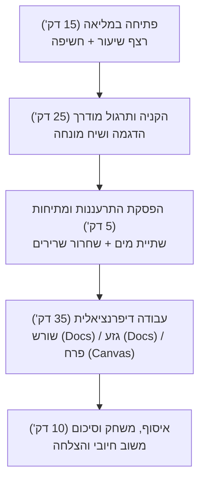

# חוברת נושאים חודשיים ומבנה שיעור כפול (90 דקות)

---

## 1. נושאים תמטיים חודשיים

| חודש עברי / לועזי | נושא תמטי | טקסטים ומקורות מומלצים |
|---|---|---|
| תשרי / ספטמבר-אוקטובר | התחלות חדשות, חשבון נפש, שיתוף פעולה | סיפורי פתיחת שנה, ערך החברות |
| חשוון / אוקטובר-נובמבר | מנהיגות, יום רבין, גבורה אזרחית | דמויות מופת, דילמות מוסריות |
| כסלו / נובמבר-דצמבר | אור וחושך, גבורה, ניסים מודרניים | המצאות טכנולוגיות, חג החנוכה |
| טבת / דצמבר-ינואר | חורף, טבע וקיימות, שמירה על הסביבה | טקסטים מדעיים, בעלי חיים בחורף |
| שבט / ינואר-פברואר | שורשים, צמיחה, ארץ ישראל (ט"ו בשבט) | מסעות, צמחים ועצים, חיבור לארץ |
| אדר / פברואר-מרץ | שמחה, הומור, תחפושות וזהויות | סאטירה קלה, קומיקס, מגילת אסתר |
| ניסן / מרץ-אפריל | יציאה מעבדות לחירות, עצמאות אישית | סיפורי התגברות, פסח |
| אייר / אפריל-מאי | זיכרון ותקומה, יום העצמאות, ירושלים | שירי ארץ ישראל, אתרים היסטוריים |
| סיוון / מאי-יוני | חג השבועות, מתן תורה, ביכורים וסיכום | מגילת רות, חסד ונתינה, סיכום שנה |

---

## 2. מבנה שיעור כפול (90 דקות) מותאם לתלמידי ASD

### עקרונות יישום ב-90 דקות:
1. **ויזואליזציה של סדר היום:** כתיבת סדר השיעור על הלוח עם ריבועי סימון V.
2. **הפסקת התרעננות יזומה:** בדיוק באמצע (אחרי 40-45 דקות) – עצירה של 5 דקות למתיחות, שתיית מים ותרגילי נשימה.
3. **עבודה דיפרנציאלית מוגדרת:** כל תלמיד יודע מראש את סביבת העבודה שלו (מחשב / דף מודפס / קלסר).
4. **מעבר הדרגתי:** אזהרה של 5 דקות לפני סיום משימה.
