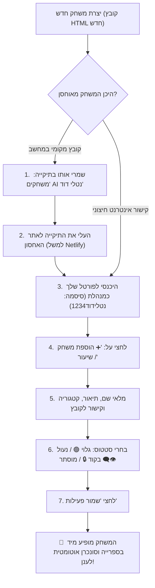

# מדריך העלאה לענן וניהול משחקים שוטף
### מאת: נטלי דוד | מרחב הלמידה והמשחקים הדיגיטליים

מדריך זה עונה בצורה ברורה ומדויקת על שתי השאלות החשובות שלך לגבי אחסון האתר ברשת והוספת משחקים חדשים.

---

## 1. תשובות ישירות לשאלות שלך

### שאלה 1: האם צריך להעלות לענן גם את תיקיית המשחקים או רק את `index.html`?
> **תשובה:** **חובה להעלות את כל התיקייה יחד (כולל תיקיית `משחקים AI נטלי דוד`)!**
> 
> **הסבר פשוט:**  
> קובץ `index.html` הוא כמו "דלפק הקבלה" או "הספרנית" של האתר – הוא מציג את התפריטים, הכרטיסיות, החיפוש והסנכרון.  
> אבל המשחקים עצמם (כמו `איקס עיגול מילות קישור.HTML`, `משחק זיכרון שבועות.HTML` וכו') הם קבצים נפרדים בתוך התיקייה.  
> אם תעלי רק את `index.html`, האתר ייפתח, אבל כשתלמיד ילחץ על "התחל פעילות", המחשב יחפש את קובץ המשחק ולא ימצא אותו (שגיאת 404).  
> לכן, מעלים את **כל תיקיית הפרויקט** בשלמותה.

---

### שאלה 2: כשמוסיפים משחק חדש, האם הוא מתווסף ישירות בענן או שצריך לשמור במחשב ולהעלות שוב?
> **תשובה:** יש להבדיל בין **קובץ המשחק** לבין **הכרטיסייה שלו בספרייה**:
> 
> 1. **הכרטיסייה בספרייה (שם המשחק, תיאור, קטגוריה, סטטוס נעילה בקוד, מוסתר/גלוי):**  
>    **נשמרת ישירות בענן!**  
>    ברגע שחיברת את Google Sheets, כל שינוי שאת עושה בממשק המנהלת באתר החי (עריכת תיאור, נעילת משחק ב-PIN, הסתרת משחק, שינוי סיסמה) נשלח ישירות לענן ה-Google Sheets.  
>    **אינך צריכה להעלות מחדש את `index.html` עבור שינויי ניהול ונעילה!**
> 
> 2. **קובץ ה-HTML של המשחק עצמו:**  
>    - **אם המשחק מאוחסן אצלך בתיקיית המחשב:** צריך לשים את קובץ ה-HTML החדש בתיקיית המשחקים ולהעלות את התיקייה המעודכנת לענן (ב-Netlify זה גרירה של שנייה).  
>    - **אם המשחק מאוחסן בקישור אינטרנטי קיים (למשל Google Drive, אתר חיצוני או יישומון שכבר ברשת):**  
>      את רק מדביקה את הקישור הישיר שלו בטופס "הוספת משחק" באתר – והוא עובד מיידית **בלי להעלות שום קובץ מחדש!**

---

## 2. שתי הדרכים הכי קלות וחינמיות להעלות את כל האתר לענן

### שיטה א' (מומלצת ביותר למורות - קלה, חינמית ובלי התקנות): Netlify Drop

בשיטה זו מקבלים כתובת אינטרנטית אמיתית (למשל: `nataly-games.netlify.app`) תוך 10 שניות בגרירת עכבר:

1. היכנסי לאתר: **[app.netlify.com/drop](https://app.netlify.com/drop)**
2. גררי את כל התיקייה **`MyWebSItes`** מהמחשב שלך היישר אל תוך העיגול המסומן בדפדפן.
3. האתר עולה מיידית לאוויר! מקבלים קישור אינטרנט קבוע שניתן לשלוח לתלמידים, להורים ולמורות.
4. **רוצה להחליף לשם יפה?**  
   בהגדרות האתר ב-Netlify לחצי על `Site configuration` ➔ `Change site name` ובחרי שם כמו `nataly-games`.

> 💡 **איך מעדכנים כשנוסף קובץ משחק חדש ב-Netlify?**  
> נכנסים שוב ל-Netlify, לוחצים על הלשונית **Deploys**, וגוררים את התיקייה המעודכנת `MyWebSItes` אל הריבוע בתחתית הדף. האתר מתעדכן תוך 3 שניות!

---

### שיטה ב': העלאה ל-GitHub Pages (למי שמשתמשת ב-GitHub)

1. פותחים Repository חדש ב-GitHub (למשל: `my-learning-portal`).
2. מעלים אליו את קובץ `index.html` ואת תיקיית `משחקים AI נטלי דוד`.
3. נכנסים ב-GitHub ל: **Settings** ➔ **Pages**.
4. תחת Branch בוחרים ב-`main` ושומרים.
5. האתר מתפרסם בכתובת קבועה: `https://your-username.github.io/my-learning-portal`.

---

## 3. תרשים זרימה: איך מוסיפים משחק חדש צעד-אחר-צעד בעתיד?

---

## 4. מה עושים כשרוצים רק לערוך, לנעול או להסתיר משחקים קיימים?

כאן היתרון העצום של הפורטל שבנינו עבורך:
- את **לא** צריכה לגעת בקבצים במחשב!
- את **לא** צריכה להעלות שום דבר מחדש לשרת!
- את פשוט נכנסת לאתר שלך מכל מכשיר (מחשב כיתה, טלפון, לפטופ), לוחצת **"כניסת מנהלת"**:
  - רוצה לנעול משחק לקראת שיעור? לחצי על כפתור ה-Toggle בכרטיסייה שלו והוא מיד נעול בקוד PIN.
  - רוצה להסתיר משחק שעדיין לא מוכן? העבירי אותו ל"מוסתר".
  - רוצה לשנות את באנר ההודעות לתלמידים? עדכני בהגדרות.
- כל הפעולות הללו נשמרות מיידית ב-**Google Sheets** שלך בענן ומתעדכנות בכל המכשירים בו-זמנית.

---

## 5. סיכום קצר וקולע

| סוג פעולה | האם צריך להעלות מחדש לאחסון האתר? | היכן מבצעים את הפעולה? |
|-----------|-----------------------------------|------------------------|
| **העלאה ראשונית של האתר** | כן – מעלים את כל התיקייה (`index.html` + תיקיית המשחקים) | ב-Netlify Drop או ב-GitHub |
| **הוספת קובץ משחק HTML חדש** | כן – גוררים שוב את התיקייה המעודכנת לאתר האחסון | ב-Netlify Drop |
| **נעילה / פתיחה של משחק** | **לא!** נשמר ישירות בענן Google Sheets | ישירות דרך האתר (מצב מנהלת) |
| **הסתרת משחק מעיני תלמידים** | **לא!** נשמר ישירות בענן Google Sheets | ישירות דרך האתר (מצב מנהלת) |
| **שינוי תיאור, קטגוריה או תגיות** | **לא!** נשמר ישירות בענן Google Sheets | ישירות דרך האתר (מצב מנהלת) |
| **החלפת הודעת באנר לתלמידים** | **לא!** נשמר ישירות בענן Google Sheets | ישירות דרך האתר (מצב מנהלת) |
